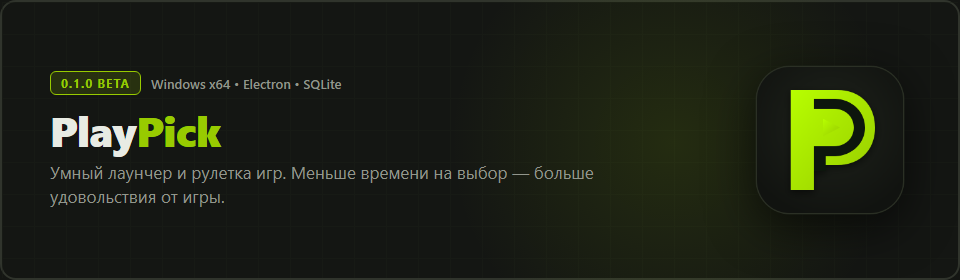
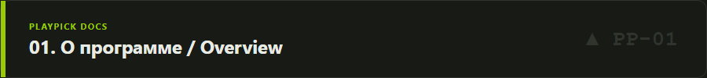
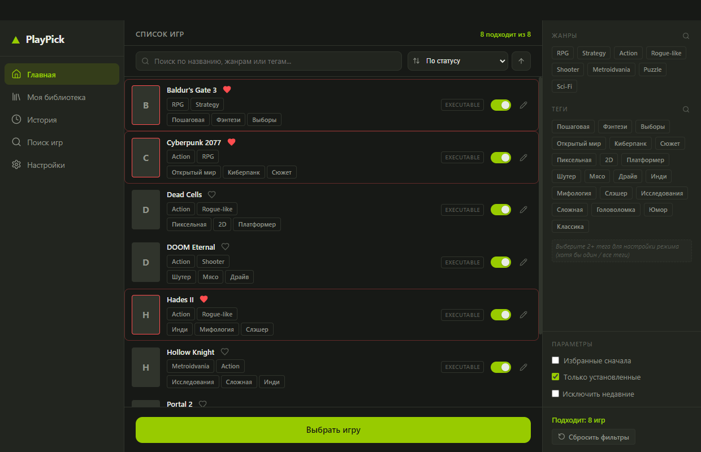
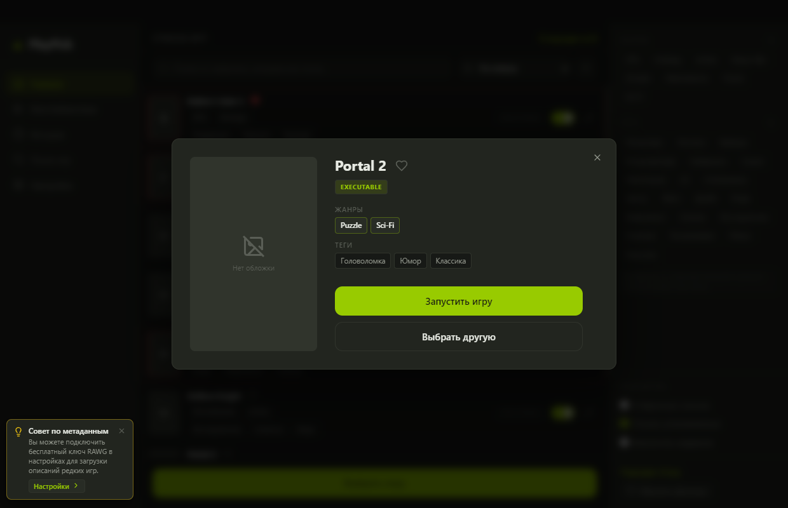
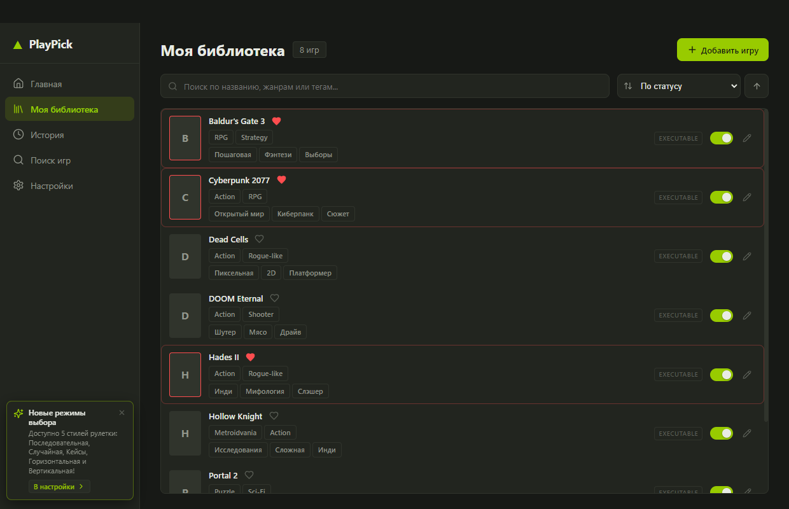
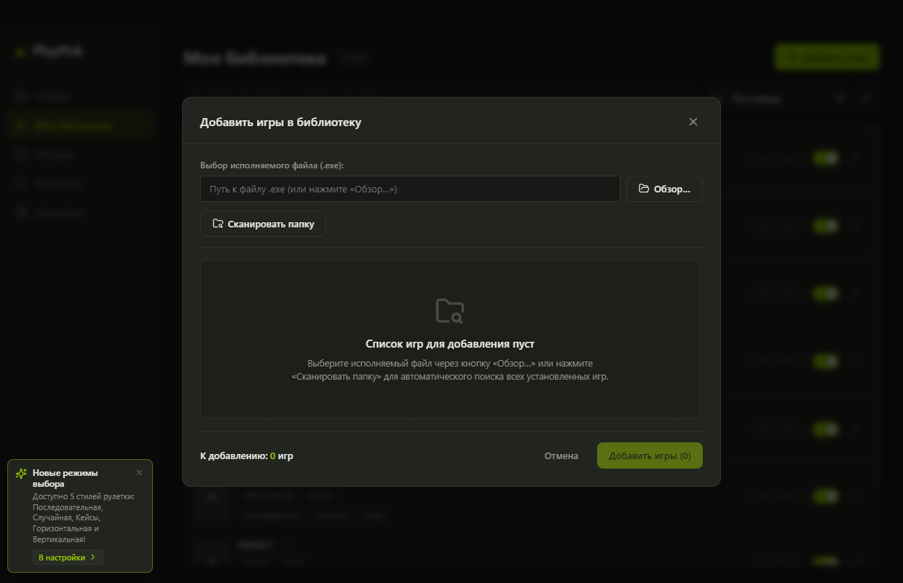
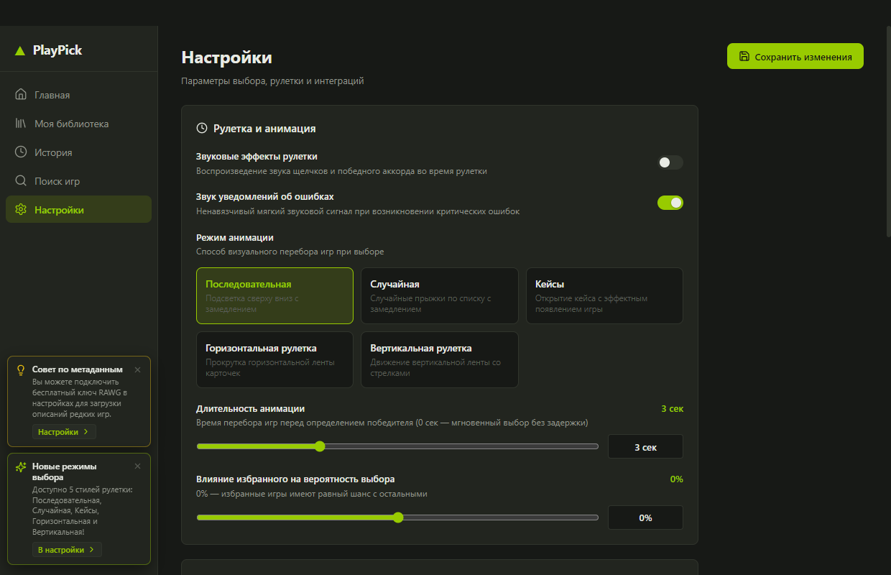
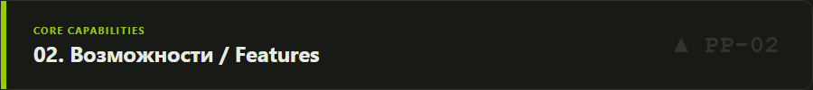
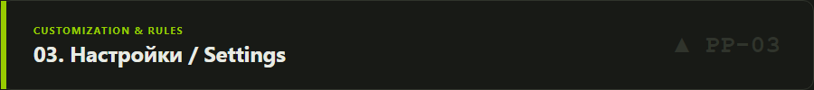
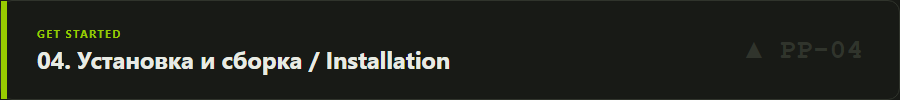

<div align="center">



# PlayPick

**Умный лаунчер и рулетка игр для Windows.**  
*Меньше времени на выбор — больше удовольствия от игры.*

[-98CB00?style=for-the-badge&logo=electron&logoColor=141613)](https://github.com/notsons-git/PlayPick/releases)
[](https://github.com/notsons-git/PlayPick/releases)
[](LICENSE)

</div>

---



## О программе

С ростом игровых коллекций в Steam, Epic Games Store, GOG и на локальных дисках каждый игрок сталкивается с **«параличом выбора»**: десятки и сотни купленных игр установлены на компьютере, но вместо того чтобы играть, вечер уходит на бесцельное листание списков.

**PlayPick** решает эту проблему:
- Объединяет установленные игры разных платформ и ручные `.exe` в единый локальный каталог.
- Позволяет в пару кликов отфильтровать игры по жанрам, тегам или статусу «Избранное».
- Выбирает идеальную игру с помощью красивой анимации рулетки и позволяет запустить её в один клик.

Приложение полностью автономно, не требует обязательной регистрации и хранит всю библиотеку в быстрой локальной базе данных **SQLite**.

---

## Интерфейс и скриншоты

<div align="center">

### Главный экран — библиотека и выбор игры
*Быстрый доступ к коллекции, многоуровневая фильтрация и запуск рулетки*


<br/>

### Результат выбора — карточка игры
*Интерактивная карточка победителя с возможностью мгновенного запуска или повтора*


<br/>

### Моя библиотека — управление и редактирование
*Поиск, сортировка по времени и алфавиту, отметка избранного и настройка тегов*


<br/>

### Добавление игр и пакетное сканирование
*Добавление одиночного .exe файла с автоопределением названия или сканирование всей папки*


<br/>

### Настройки приложения
*Тонкая настройка физики рулетки, весов избранного, режима запуска и интеграций*


</div>

---



## Возможности

- **5 режимов рулетки выбора**:
  1. *Последовательная*: плавное переключение сверху вниз с динамическим замедлением.
  2. *Случайная*: скачки подсветки между случайными кандидатами.
  3. *Кейсы (CS-style)*: горизонтальная лента с центральным указателем.
  4. *Горизонтальное колесо*: круговой барабан в горизонтальной плоскости.
  5. *Вертикальное колесо*: эффект классического слота с инерционным торможением.
- **Интеллектуальная система шансов (Избранное)**:
  - Настройка влияния статуса «Избранное» (от 0% до +500% бонуса к шансу выпадения).
  - Наглядный расчёт вероятности в реальном времени.
- **3 режима запуска после выбора**:
  - *Подтверждение*: карточка результата ожидает нажатия кнопки пользователем.
  - *Таймер (3 секунды)*: обратный отсчёт с кнопкой отмены перед автозапуском.
  - *Мгновенный*: прямой запуск исполняемого файла игры сразу после остановки барабана.
- **Умная защита от дубликатов**:
  - Автоматическая нормализация путей Windows (слеши, регистр, кавычки).
  - Слияние статистики и тегов при повторном добавлении той же игры.
- **Глубокая фильтрация и теги**:
  - Множественный выбор жанров и тегов.
  - Режимы объединения тегов: «Любой из выбранных» или «Все выбранные одновременно».
  - Исключение недавно сыгранных игр (настраиваемый интервал в днях).
- **Звуковое сопровождение**:
  - Синтезированные звуковые эффекты прокрутки (Web Audio API) без задержек.

---



## Настройки приложения

В разделе **«Настройки»** доступны параметры кастомизации:

| Параметр | Описание | Значение по умолчанию |
| :--- | :--- | :--- |
| **Режим рулетки** | Стиль анимации при выборе игры | `Последовательная` |
| **Длительность анимации** | Время прокрутки (от 1.0 до 15.0 сек) | `5.0 сек` |
| **Вес избранных игр** | Приоритет карточек с сердечком при жеребьёвке | `0% (равные шансы)` |
| **Способ запуска** | Поведение после остановки выбора | `Подтверждение` |
| **Звуковые эффекты** | Озвучка щелчков рулетки и победного фанфара | `Включено` |
| **Звуки уведомлений** | Звук всплывающих подсказок системы | `Включено` |
| **Ключи API (RAWG / SteamGridDB)** | Загрузка постеров высокого разрешения | `Не заданы (опционально)` |

---

## Добавление игр в библиотеку

PlayPick поддерживает несколько простых способов наполнения каталога:

1. **Одиночный исполняемый файл**:
   - Перейдите в *«Моя библиотека»* $\rightarrow$ *«Добавить игру»*.
   - Вставьте путь или нажмите **«Обзор…»** для выбора `.exe`.
   - Название игры, путь установки и базовая информация определятся автоматически.
2. **Сканирование каталога**:
   - Нажмите **«Сканировать папку»** и укажите директорию с играми (например, `D:\Games`).
   - PlayPick рекурсивно найдёт корневые исполняемые файлы, отфильтрует вспомогательные утилиты (`crash_handler.exe`, `unins000.exe`, `dxwebsetup.exe`) и сформирует карточки для импорта.
3. **Редактирование метаданных**:
   - Для любой игры можно отредактировать пользовательские жанры, теги, обложку или команду запуска.

---



## Установка

Готовый установщик доступен на странице релизов:

1. Перейдите в [**GitHub Releases**](https://github.com/notsons-git/PlayPick/releases/tag/v0.1.0-beta).
2. Скачайте файл **`PlayPick-Setup-0.1.0.exe`**.
3. Запустите установщик и следуйте простым инструкциям мастера Windows.
4. Запустите PlayPick через ярлык на рабочем столе или из меню «Пуск».

> [!NOTE]
> Это первая публичная **Beta-версия (0.1.0)**. При обнаружении ошибок или предложений по улучшению, пожалуйста, создавайте обращение в [GitHub Issues](https://github.com/notsons-git/PlayPick/issues).

---

## Сборка из исходного кода

Для самостоятельной сборки потребуется установленный **Node.js 18+** и **npm**:

```bash
# 1. Клонирование репозитория
git clone https://github.com/notsons-git/PlayPick.git
cd PlayPick

# 2. Установка зависимостей
npm install

# 3. Запуск в режиме разработки (Vite + Electron Hot-Reload)
npm run dev

# 4. Запуск юнит-тестов (95 тестов)
npm test

# 5. Проверка типов TypeScript
npm run typecheck
npm run typecheck:electron

# 6. Сборка готового Windows-установщика (NSIS x64)
npm run build:dist
```

Собранный исполняемый установщик будет сохранён в каталоге `release/`.

---

## Данные и безопасность

- **Локальное хранилище**: Все данные (игры, теги, настройки, история выбора) сохраняются локально на вашем компьютере по пути `%APPDATA%\playpick\playpick.db`.
- **Никакой телеметрии**: Приложение не собирает персональные данные и не передаёт аналитику.
- **Внешние запросы**: Сетевые запросы выполняются исключительно при указании собственных API-ключей для скачивания обложек из открытых каталогов (RAWG / SteamGridDB).

---

## Лицензия

Проект распространяется под свободной лицензией **MIT**. Подробности в файле [LICENSE](LICENSE).
